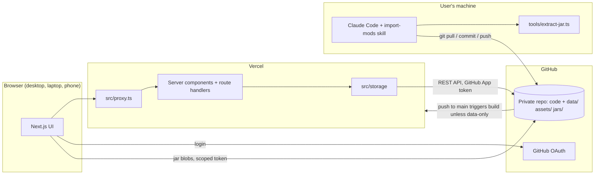
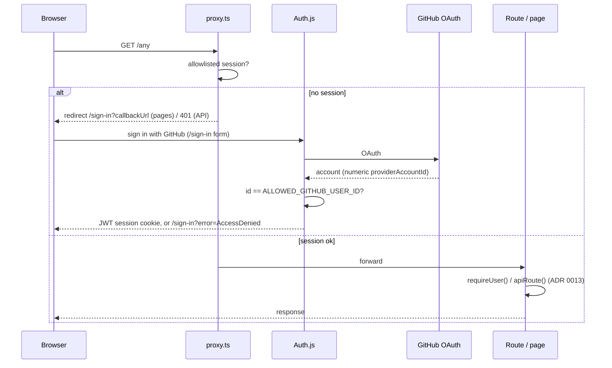
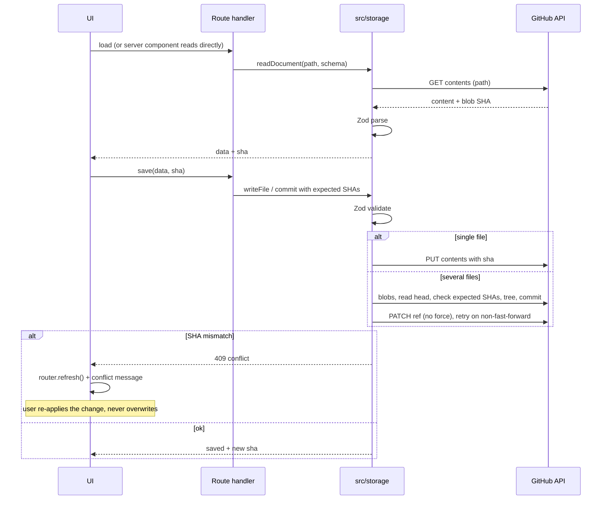
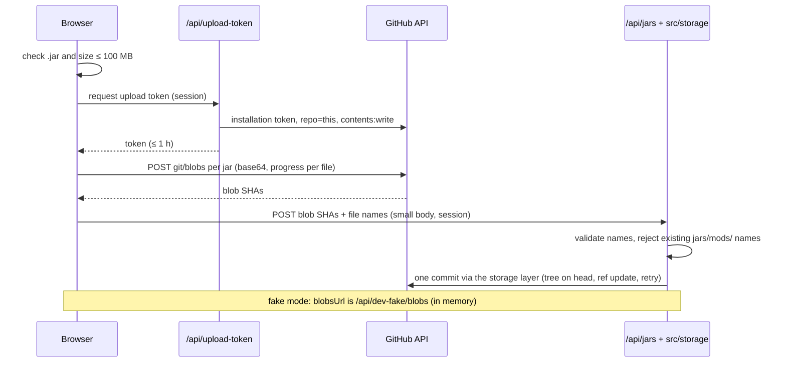
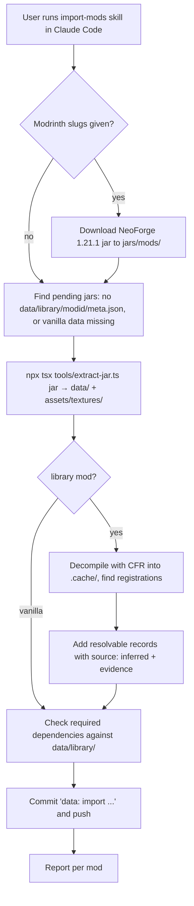
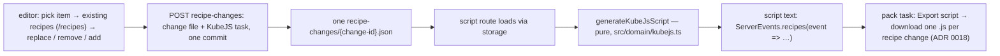

# Architecture

**Status markers:** parts marked **(planned)** do not exist yet; do not import or call them until a phase implements them. Unmarked parts exist now. When a phase implements a planned part, remove its marker in the same change.

**Current state, phase 1 (foundation, spec `docs/specs/01-foundation.md`):**

- exists: auth, proxy, storage layer, texture/icon routes, i18n, theming, app shell, and create/rename/delete for custom mods and modpacks;
- planned at the time: entries, library, uploads, recipes, tasks, mind map.

**Phase 2 (jar extraction, spec `docs/specs/02-jar-extraction.md`):**

- exists: `tools/extract-jar.ts` and the library data schemas in `src/domain/library.ts` (ADR 0017).

**Phase 3 (Modpack Planner, spec `docs/specs/03-modpack-planner.md`):**

- exists: library page with jar upload, mod logos (ADR 0019), pack mods with dependency and compatibility warnings, the item search modal, recipe changes with visual editors, KubeJS export per change (ADR 0018), pack task list (ADR 0020).
- planned at the time: entries, designer tasks, mind map (phases 4–6).

**Phase 4 (Mod Designer entries, spec `docs/specs/04-mod-designer-entries.md`):**

- exists: entries of six types with Zod discriminated unions (ADR 0009, 0021), entry recipes including custom machine recipe types, relations, the 16×16 pixel editor and entry icons, custom mod dependencies, the designer item set; the pack item set includes planned/implemented entries.
- planned: designer tasks and taskboard (phase 5), mind map (phase 6).

## System overview



## Components

| Component         | Responsibility                                                                                                                                                                                                                    | Status     |
| ----------------- | --------------------------------------------------------------------------------------------------------------------------------------------------------------------------------------------------------------------------------- | ---------- |
| Next.js app       | UI for Mod Designer and Modpack Planner, server components, route handlers (ADR 0001, 0013)                                                                                                                                       | exists     |
| Proxy             | `src/proxy.ts`: every request needs the allowlisted session; pages → `/sign-in`, API → 401 (ADR 0004)                                                                                                                             | exists     |
| Auth              | `src/server/auth.ts` (Auth.js, GitHub provider, allowlist), `src/server/session.ts` (`requireUser`, `getAllowedUser`)                                                                                                             | exists     |
| Storage layer     | `src/storage/`: backend interface, GitHub and in-memory backends, documents, repositories (ADR 0002)                                                                                                                              | exists     |
| GitHub App client | `src/server/github-app.ts`: one installation token per request, repo-scoped, contents write (ADR 0003)                                                                                                                            | exists     |
| Texture routes    | `/api/textures/[...path]` → `assets/textures/`, `/api/icons/[...path]` → `assets/icons/`, behind auth (ADR 0004)                                                                                                                  | exists     |
| i18n              | `src/i18n/`: typed en/de catalogs, cookie locale (ADR 0012)                                                                                                                                                                       | exists     |
| Theming           | `src/theme/`: tokens for 3 themes × light/dark, CSS render, contrast test (ADR 0011)                                                                                                                                              | exists     |
| App shell         | `src/components/shell/`: view switcher, project selector with create/rename/delete, settings                                                                                                                                      | exists     |
| Dev fake mode     | In-memory storage + fake login under `next dev` only (ADR 0014)                                                                                                                                                                   | exists     |
| Domain            | `src/domain/`: IDs, project and library schemas, recipe model, recipe changes, KubeJS export, pack tasks, compatibility, search, entry schemas (`entry.ts`), custom recipe types, pixel image core; designer task rules (planned) | partial    |
| Library page      | `/library`: library mods with logo, counts and compatibility badge; pending jars; "Upload jars" (spec 03)                                                                                                                         | exists     |
| Jar upload        | `POST /api/upload-token` (scoped token), browser `git/blobs`, `POST /api/jars` commits through storage (ADR 0005)                                                                                                                 | exists     |
| Modpack Planner   | `/modpacks/[packId]`: mods, warnings, recipe changes, tasks; editor at `/modpacks/[packId]/recipe-changes/new` and `/[changeId]`                                                                                                  | exists     |
| Item search modal | `src/components/items/item-search-dialog.tsx`: shared, fuzzy, capped, items or tags (reused by the designer in phase 4)                                                                                                           | exists     |
| Extraction script | `tools/extract-jar.ts` + `tools/extract-jar/`: deterministic jar → data (ADR 0006, 0017)                                                                                                                                          | exists     |
| import-mods skill | `.claude/skills/import-mods/SKILL.md`: runs the script, adds inferred data, commits (ADR 0006)                                                                                                                                    | exists     |
| Vercel build skip | `vercel.json` `ignoreCommand`: skips builds for commits touching only `data/`, `assets/`, `jars/` (ADR 0002)                                                                                                                      | configured |

## Source layers

| Folder            | Contains                                                                                                                                                                                     | May import                             |
| ----------------- | -------------------------------------------------------------------------------------------------------------------------------------------------------------------------------------------- | -------------------------------------- |
| `src/app/`        | Routes: pages, layouts (`(app)` group = signed-in shell), route handlers in `src/app/api/` wrapped in `apiRoute()` (`src/app/api/_lib/route.ts`). Thin.                                      | everything below                       |
| `src/components/` | React components: `ui/` (Button, IconButton, Dialog, TextField, form fields, Toast, `useApiFailure`), `shell/`, `items/`, `recipes/`, `modpacks/`, `library/`, `designer/`, `pixel-editor/`. | `domain`, `i18n`, `theme`, `lib`       |
| `src/domain/`     | Pure TypeScript: Zod schemas and inferred types, ID rules, recipe model and parsing, KubeJS generator, pack task operations, compatibility, fuzzy search.                                    | `lib` only (no I/O, React, Next, Node) |
| `src/storage/`    | The only code that reads or writes repo data. `getStorage()` and cached loaders in `index.ts`; repositories per document kind.                                                               | `domain`, `server`, `lib`              |
| `src/server/`     | Server-only infrastructure: `env.ts`, `auth.ts`, `session.ts`, `access.ts` (pure rules), `github-app.ts`, `dev-fake.ts`.                                                                     | `lib`                                  |
| `src/i18n/`       | `messages/en.ts` (source of keys), `messages/de.ts`, `locale.ts`, `server.ts` (`getT`), `client.tsx` (`useT`).                                                                               | `lib`                                  |
| `src/theme/`      | `tokens.ts` (all colors), `render-css.ts`, `contrast.ts`.                                                                                                                                    | nothing                                |
| `src/lib/`        | Small generic helpers (`assert-never`, `fetch-json`, `preferences`, `stable-json` with `compareCodeUnits`).                                                                                  | nothing app-specific                   |
| `tools/`          | CLI scripts run with `npx tsx tools/<script>.ts`.                                                                                                                                            | `domain`, `lib`                        |

ESLint (`eslint.config.mjs`) enforces the key boundaries:

- `@octokit/*` is only allowed in `src/storage/` and `src/server/`.
- `src/components/` must not import `@/storage` or `@/server`.
- `src/domain/` must not import React, Next, Node built-ins or upper layers.
- `tools/` may import `src/domain` and `src/lib` (relative imports, so `npx tsx` needs no path aliases).
- `src/app/` and `src/components/` must not contain hex colors or color functions (ADR 0011).

**Data access rules:**

- Server components read through the storage layer (`loadCustomMods()`, …).
- Client components get data as props or from route handlers; they never call GitHub.
- Mutations go through route handlers that call storage functions. The client sends the blob SHA it read; on `409 { error: "conflict" }` it calls `router.refresh()` and shows `errors.conflict`.

**Tests:** colocated `*.test.ts(x)`, run with Vitest in Node. Storage logic is tested on `MemoryBackend` (same semantics as GitHub, real blob SHAs); `GitHubBackend` is tested against a fake `GitHubApi`.

## Storage layer

- **`StorageBackend`** (`src/storage/types.ts`):
  - `readFile`, `listDir`, `listFilesRecursive`
  - `writeFile(path, content, expectedSha | null)`: create-only when `null`
  - `deleteFile`
  - `commit({ message, changes, expected })`. A change is `{ path, content }` (`null` deletes) or `{ path, blobSha }` for a blob the browser already uploaded (jar upload, ADR 0005).
- **`GitHubBackend`:**
  - Single files use the Contents API with the blob SHA. A 409 is retried once if the file itself is unchanged.
  - A multi-file `commit`:
    - creates the blobs (uploaded blobs are used by SHA; an unknown one → `ValidationError("unknownBlob")`);
    - reads the head and checks every `expected` SHA there (mismatch → `ConflictError`, nothing written);
    - creates the tree on `base_tree` (deletions are `sha: null`), then the commit;
    - fast-forwards the ref. On a non-fast-forward it rebuilds at the new head, up to 3 attempts, then raises `ConflictError`.
- **Errors:**
  - `ConflictError`, `NotFoundError`, `ValidationError(code)`.
  - Use the name-based guards (`isConflictError`, …), not `instanceof` (ADR 0014).
  - `apiRoute()` maps them to 409 / 404 / 400.
- **Documents:** `readDocument(storage, path, schema)` returns `{ data, sha }` validated by Zod. `encodeDocument(schema, value)` validates and serializes with `stableStringify` (sorted keys, 2 spaces, trailing newline).
- **Commit messages:** `data: <verb> <kind> <id>`, e.g. `data: create custom mod iron_works`, `data: add recipe change my-pack/iron_pickaxe`, `data: upload jars a.jar, b.jar`.
- **Library data** (`src/storage/library.ts`): one `listFilesRecursive("data/library")` plus a listing of `data/vanilla/1.21.1/` give every file's blob SHA; parsed files go through the shared cache in `cached.ts` (keyed by `path@sha`, 256 entries, also used for entries), so a warm instance re-reads only changed files. `loadPackItemSources` (`pack-items.ts`) returns vanilla + a pack's library mods.
- **Recipe changes** (`recipe-changes.ts`): create, edit and delete each write the change file and `tasks.json` in one commit (ADR 0020). Pack task writes (`pack-tasks.ts`) use the `tasks.json` SHA the client last saw.
- **Entries** (`entries.ts`): listed with one tree call and read through the SHA-keyed cache (`cached.ts`). Create/update write the entry and its icon (`assets/icons/<modid>/<path>.png`, validated 16×16 PNG) in one commit and check relation targets and recipe types (references the stored version already had stay allowed). Delete removes the entry, its icon and manual relations to it in other entries, in one commit (ADR 0021).
- **Custom mods** (`custom-mods.ts`): dependencies (existing library mods only) and recipe types (machine must be a block or multiblock entry) are written to `mod.json` with its SHA.
- **Item sets** (`pack-items.ts`): `loadPackItemSources` (vanilla + pack library mods + planned/implemented item/block entries of the pack's custom mods) and `loadDesignerItemSources` (vanilla + declared dependencies + all item/block entries).

## API routes

All are wrapped in `apiRoute()` (session check, error mapping).

| Route                                                     | Methods                  | Purpose                                                            |
| --------------------------------------------------------- | ------------------------ | ------------------------------------------------------------------ |
| `/api/custom-mods[/[modId]]`, `/api/modpacks[/[packId]]`  | GET, POST, PATCH, DELETE | projects (phase 1)                                                 |
| `/api/custom-mods/[modId]/dependencies`                   | PUT                      | set the custom mod's library dependencies                          |
| `/api/custom-mods/[modId]/recipe-types[/[typeId]]`        | POST, PUT, DELETE        | custom machine recipe types                                        |
| `/api/custom-mods/[modId]/entries[/[entryPath]]`          | POST, PUT, DELETE        | entries with their icon (base64 PNG in the body)                   |
| `/api/custom-mods/[modId]/search-set`                     | GET                      | the designer item set                                              |
| `/api/textures/[...path]`, `/api/icons/[...path]`         | GET                      | PNGs from `assets/` with ETag                                      |
| `/api/upload-token`                                       | POST                     | scoped installation token + blobs URL for the browser (`no-store`) |
| `/api/dev-fake/blobs`                                     | POST                     | fake mode only: stands in for `git/blobs`; 404 otherwise           |
| `/api/jars`                                               | POST                     | commit uploaded blobs to `jars/mods/` in one commit                |
| `/api/modpacks/[packId]/mods`                             | PUT                      | set the pack's library and custom mods                             |
| `/api/modpacks/[packId]/search-set`                       | GET                      | items and tags of the pack's item set                              |
| `/api/modpacks/[packId]/recipes?item=`                    | GET                      | existing recipes producing an item                                 |
| `/api/modpacks/[packId]/recipe-changes[/[changeId]]`      | POST, PUT, DELETE        | recipe changes (with their KubeJS task)                            |
| `/api/modpacks/[packId]/recipe-changes/[changeId]/script` | GET                      | KubeJS script download                                             |
| `/api/modpacks/[packId]/tasks[/[taskId]]`                 | POST, PATCH, DELETE      | manual tasks; check/uncheck                                        |

## Data layout

All paths are relative to the repo root. Files appear as phases implement them; the Zod schemas in `src/domain/` are the source of truth for every implemented format. All Minecraft IDs are namespaced (`namespace:path`).

```
jars/vanilla/                       vanilla 1.21.1 client jar
jars/mods/                          third-party mod jars (≤ 100 MB each)
data/vanilla/1.21.1/{items,recipes,tags}.json
data/library/<modid>/{meta,items,recipes,tags}.json
data/custom-mods/<modid>/{mod,layout,tasks}.json + entries/<path>.json (entry ID <modid>:<path>)
data/modpacks/<pack-id>/{pack,tasks}.json + recipe-changes/<change-id>.json
assets/textures/<namespace>/        PNGs extracted from jars (vanilla and library mods); <modid>/_logo.png = mod logo
assets/icons/<custom-modid>/        16×16 PNG icons drawn in the pixel editor: <entry path>.png
tools/extract-jar.ts                deterministic extraction CLI (spec 02)
```

| File                                                      | Holds (high level)                                                                                                                                                                                                                   | Written by         | Status  |
| --------------------------------------------------------- | ------------------------------------------------------------------------------------------------------------------------------------------------------------------------------------------------------------------------------------ | ------------------ | ------- |
| `data/custom-mods/<modid>/mod.json`                       | `customModSchema`: `{ modId, name, phase ("planning"), dependencies (library mod IDs), recipeTypes (custom machine recipe types, ADR 0021) }`                                                                                        | app                | exists  |
| `data/modpacks/<pack-id>/pack.json`                       | `modpackSchema`: `{ id, name, libraryModIds: [], customModIds: [] }`                                                                                                                                                                 | app                | exists  |
| `data/vanilla/1.21.1/items.json`, library `items.json`    | `libraryItemSchema`: `[{ id, name (English), icon (path under assets/textures) or null, iconFallback?, source, evidence? }]`                                                                                                         | extraction + skill | exists  |
| `.../recipes.json`                                        | `libraryRecipeSchema`: `[{ id, type, source, evidence?, data (raw recipe JSON) }]`                                                                                                                                                   | extraction + skill | exists  |
| `.../tags.json`                                           | `itemTagsSchema`: `{ "<tag-id>": { replace, values: ["<item-id>" or "#<tag-id>" or { id, required }] } }`                                                                                                                            | extraction         | exists  |
| `data/library/<modid>/meta.json`                          | `libraryMetaSchema`: modId, name, version, loader (`neoforge`/`forge`/`fabric`), minecraftVersionRange, modIds, jarFile, jarSha256, dependencies, logo (ADR 0019); non-NeoForge-1.21.1 mods are imported but warned about (ADR 0016) | extraction         | exists  |
| `data/custom-mods/<modid>/layout.json`                    | mind map node positions per entry ID                                                                                                                                                                                                 | app                | planned |
| `data/custom-mods/<modid>/tasks.json`                     | manual tasks; per-key state for generated tasks if the Designer spec needs it                                                                                                                                                        | app                | planned |
| `data/custom-mods/<modid>/entries/<path>.json`            | `entrySchema`: `{ id (<modid>:<path>), type, kind?, name, description, status, tags, icon, usage, notes, relations }` + type-specific fields; `recipes` on item/block entries (ADR 0009, 0021)                                       | app                | exists  |
| `data/modpacks/<pack-id>/tasks.json`                      | `packTasksSchema`: `{ tasks: [{ id, type: "manual", title, done } or { id, type: "kubejs", recipeChangeId, done }] }` (ADR 0020)                                                                                                     | app                | exists  |
| `data/modpacks/<pack-id>/recipe-changes/<change-id>.json` | `recipeChangeSchema`: `{ id, item, itemName, action: "add" \| "replace" \| "remove", replacedRecipeId? / removedRecipeId?, recipe? }`; `recipe` is a visual type or `{ type: "json", data }` (ADR 0020)                              | app                | exists  |

**Rules:**

- `data/custom-mods/` and `data/modpacks/` are written only by the app; `data/library/` and `data/vanilla/` only by the import.
- Custom mod and modpack IDs are immutable folder names; deleting a custom mod also removes it from every pack, in one commit (ADR 0015).
- Prettier ignores `data/`, `assets/` and `jars/`; their writers define the formatting.

## Flows

### Login and authorization



### Read and write via the storage layer



### Jar upload



### Import pipeline



The CFR jar and decompiled sources go in `.cache/` (created on demand, gitignored).

### Recipe change and KubeJS export



## Environment variables

All of them are listed in `.env.example`.

- **Auth.js** reads `AUTH_SECRET`, `AUTH_GITHUB_ID` and `AUTH_GITHUB_SECRET` itself.
- **`src/server/env.ts`** reads:
  - `ALLOWED_GITHUB_USER_ID` (`allowedGithubUserId()`)
  - the GitHub App and repo variables (`githubEnv()`, validated on use)
- **`MINEFORGE_DEV_FAKE=1`** enables fake mode under `next dev` (ADR 0014). **`MINEFORGE_DEV_SEED_DIR`** (fake mode only, `devSeedDir()`) seeds the fake store's library and vanilla data from a folder of extracted data instead of the built-in fixture.

Never read `process.env` in features.

## Framework notes

- Next.js 16.4 with Cache Components and Partial Prefetching **off** (ADR 0013), and Tailwind v4 through the `@tailwindcss/turbopack` loader (no PostCSS config).
- The middleware file is `src/proxy.ts`. Auth.js is `next-auth@5.0.0-beta.32`, pinned.
- Route handler and page props use the generated global types (`PageProps<"/route">`, `LayoutProps`); `npm run typecheck` runs `next typegen` first.
- There is no `public/` folder. Next.js serves it without auth, so textures and icons never go there (ADR 0004).
- Version-matched Next.js docs are in `node_modules/next/dist/docs/`; `AGENTS.md` is maintained by `next dev` and says the same.
- Local runs: `.claude/launch.json` has `dev-fake` (port 3100, fake mode) and `dev` (real auth). Only one `next dev` can run per folder.
