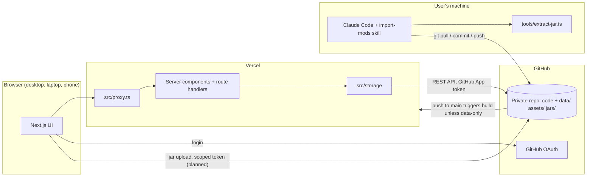
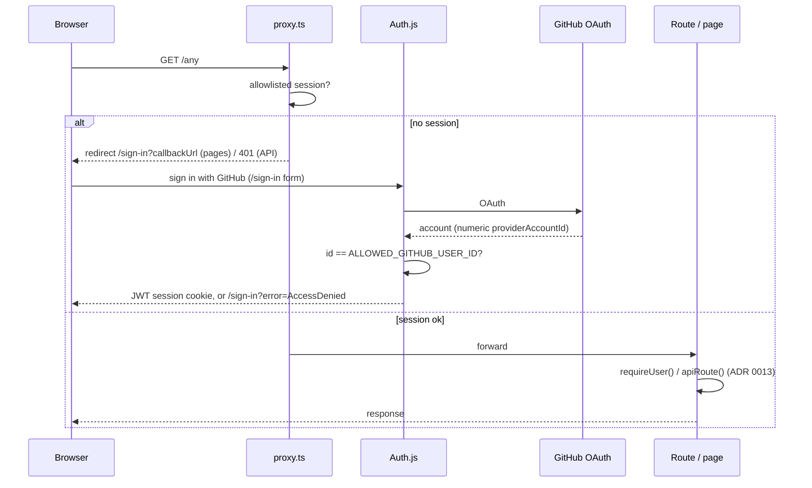
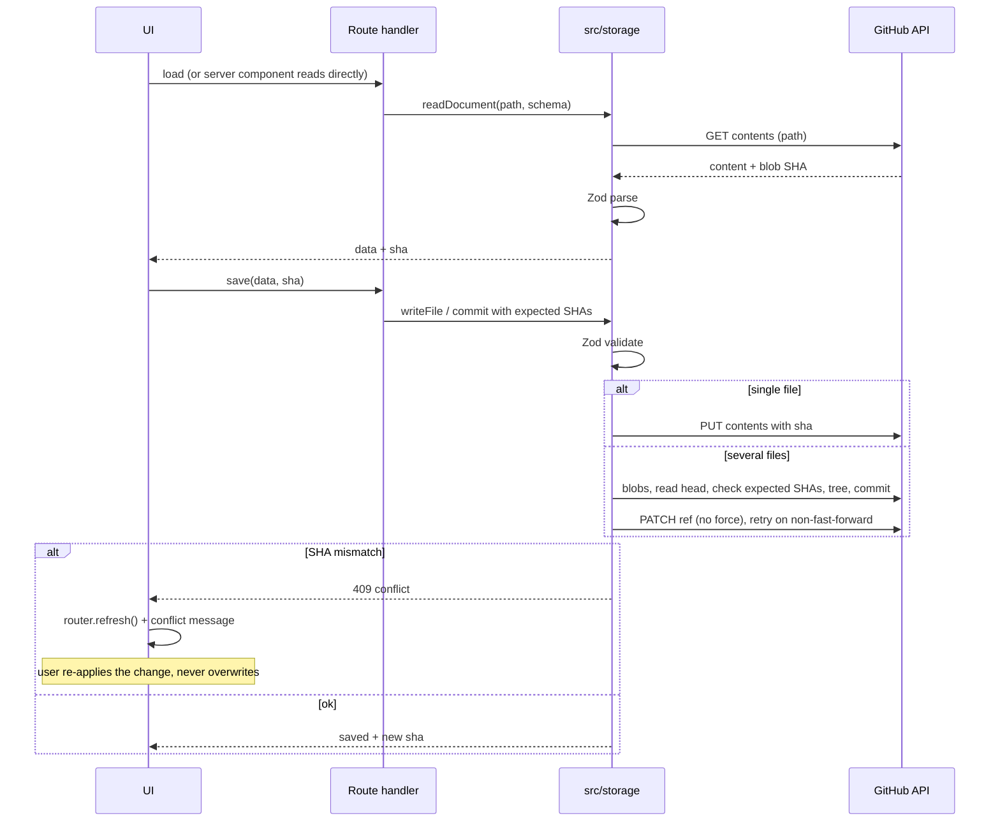
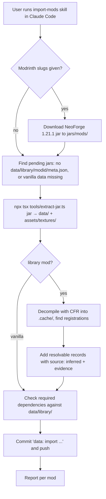
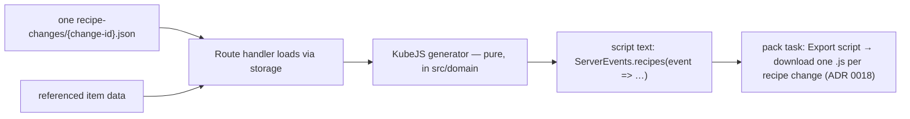

# Architecture

**Status markers:** parts marked **(planned)** do not exist yet; do not import or call them until a phase implements them. Unmarked parts exist now. When a phase implements a planned part, remove its marker in the same change.

**Current state, phase 1 (foundation, spec `docs/specs/01-foundation.md`):**

- exists: auth, proxy, storage layer, texture/icon routes, i18n, theming, app shell, and create/rename/delete for custom mods and modpacks;
- planned: entries, library, uploads, recipes, tasks, mind map.

**Phase 2 (jar extraction, spec `docs/specs/02-jar-extraction.md`):**

- exists: `tools/extract-jar.ts` and the library data schemas in `src/domain/library.ts` (ADR 0017).

## System overview



## Components

| Component         | Responsibility                                                                                                                        | Status     |
| ----------------- | ------------------------------------------------------------------------------------------------------------------------------------- | ---------- |
| Next.js app       | UI for Mod Designer and Modpack Planner, server components, route handlers (ADR 0001, 0013)                                           | exists     |
| Proxy             | `src/proxy.ts`: every request needs the allowlisted session; pages → `/sign-in`, API → 401 (ADR 0004)                                 | exists     |
| Auth              | `src/server/auth.ts` (Auth.js, GitHub provider, allowlist), `src/server/session.ts` (`requireUser`, `getAllowedUser`)                 | exists     |
| Storage layer     | `src/storage/`: backend interface, GitHub and in-memory backends, documents, repositories (ADR 0002)                                  | exists     |
| GitHub App client | `src/server/github-app.ts`: one installation token per request, repo-scoped, contents write (ADR 0003)                                | exists     |
| Texture routes    | `/api/textures/[...path]` → `assets/textures/`, `/api/icons/[...path]` → `assets/icons/`, behind auth (ADR 0004)                      | exists     |
| i18n              | `src/i18n/`: typed en/de catalogs, cookie locale (ADR 0012)                                                                           | exists     |
| Theming           | `src/theme/`: tokens for 3 themes × light/dark, CSS render, contrast test (ADR 0011)                                                  | exists     |
| App shell         | `src/components/shell/`: view switcher, project selector with create/rename/delete, settings                                          | exists     |
| Dev fake mode     | In-memory storage + fake login under `next dev` only (ADR 0014)                                                                       | exists     |
| Domain            | `src/domain/`: IDs, `mod.json`/`pack.json` and library data schemas; entry schemas, task rules, recipe model, KubeJS export (planned) | partial    |
| Upload token      | Scoped token for direct jar upload (ADR 0005)                                                                                         | planned    |
| Extraction script | `tools/extract-jar.ts` + `tools/extract-jar/`: deterministic jar → data (ADR 0006, 0017)                                              | exists     |
| import-mods skill | `.claude/skills/import-mods/SKILL.md`: runs the script, adds inferred data, commits (ADR 0006)                                        | exists     |
| Vercel build skip | `vercel.json` `ignoreCommand`: skips builds for commits touching only `data/`, `assets/`, `jars/` (ADR 0002)                          | configured |

## Source layers

| Folder            | Contains                                                                                                                                                | May import                             |
| ----------------- | ------------------------------------------------------------------------------------------------------------------------------------------------------- | -------------------------------------- |
| `src/app/`        | Routes: pages, layouts (`(app)` group = signed-in shell), route handlers in `src/app/api/` wrapped in `apiRoute()` (`src/app/api/_lib/route.ts`). Thin. | everything below                       |
| `src/components/` | React components: `ui/` (Button, IconButton, Dialog, TextField, Toast), `shell/`; later `designer/`, `modpacks/` (planned).                             | `domain`, `i18n`, `theme`, `lib`       |
| `src/domain/`     | Pure TypeScript: Zod schemas and inferred types, ID rules; later task rules, recipe model, KubeJS export.                                               | `lib` only (no I/O, React, Next, Node) |
| `src/storage/`    | The only code that reads or writes repo data. `getStorage()` and cached loaders in `index.ts`; repositories per document kind.                          | `domain`, `server`, `lib`              |
| `src/server/`     | Server-only infrastructure: `env.ts`, `auth.ts`, `session.ts`, `access.ts` (pure rules), `github-app.ts`, `dev-fake.ts`.                                | `lib`                                  |
| `src/i18n/`       | `messages/en.ts` (source of keys), `messages/de.ts`, `locale.ts`, `server.ts` (`getT`), `client.tsx` (`useT`).                                          | `lib`                                  |
| `src/theme/`      | `tokens.ts` (all colors), `render-css.ts`, `contrast.ts`.                                                                                               | nothing                                |
| `src/lib/`        | Small generic helpers (`assert-never`, `fetch-json`, `preferences`, `stable-json` with `compareCodeUnits`).                                             | nothing app-specific                   |
| `tools/`          | CLI scripts run with `npx tsx tools/<script>.ts`.                                                                                                       | `domain`, `lib`                        |

ESLint (`eslint.config.mjs`) enforces the key boundaries:

- `@octokit/*` is only allowed in `src/storage/` and `src/server/`.
- `src/components/` must not import `@/storage` or `@/server`.
- `src/domain/` must not import React, Next, Node built-ins or upper layers.
- `tools/` may import `src/domain` and `src/lib` (relative imports, so `npx tsx` needs no path aliases).
- `src/app/` and `src/components/` must not contain hex colors or color functions (ADR 0011).

**Data access rules:**

- Server components read through the storage layer (`loadCustomMods()`, …).
- Client components get data as props or from route handlers; they never call GitHub.
- Mutations go through route handlers that call storage functions. The client sends the blob SHA it read; on `409 { error: "conflict" }` it calls `router.refresh()` and shows `errors.conflict`.

**Tests:** colocated `*.test.ts(x)`, run with Vitest in Node. Storage logic is tested on `MemoryBackend` (same semantics as GitHub, real blob SHAs); `GitHubBackend` is tested against a fake `GitHubApi`.

## Storage layer

- **`StorageBackend`** (`src/storage/types.ts`):
  - `readFile`, `listDir`, `listFilesRecursive`
  - `writeFile(path, content, expectedSha | null)`: create-only when `null`
  - `deleteFile`
  - `commit({ message, changes, expected })`
- **`GitHubBackend`:**
  - Single files use the Contents API with the blob SHA. A 409 is retried once if the file itself is unchanged.
  - A multi-file `commit`:
    - creates the blobs;
    - reads the head and checks every `expected` SHA there (mismatch → `ConflictError`, nothing written);
    - creates the tree on `base_tree` (deletions are `sha: null`), then the commit;
    - fast-forwards the ref. On a non-fast-forward it rebuilds at the new head, up to 3 attempts, then raises `ConflictError`.
- **Errors:**
  - `ConflictError`, `NotFoundError`, `ValidationError(code)`.
  - Use the name-based guards (`isConflictError`, …), not `instanceof` (ADR 0014).
  - `apiRoute()` maps them to 409 / 404 / 400.
- **Documents:** `readDocument(storage, path, schema)` returns `{ data, sha }` validated by Zod. `encodeDocument(schema, value)` validates and serializes with `stableStringify` (sorted keys, 2 spaces, trailing newline).
- **Commit messages:** `data: <verb> <kind> <id>`, e.g. `data: create custom mod iron_works`.

## Data layout

All paths are relative to the repo root. Files appear as phases implement them; the Zod schemas in `src/domain/` are the source of truth for every implemented format. All Minecraft IDs are namespaced (`namespace:path`).

```
jars/vanilla/                       vanilla 1.21.1 client jar
jars/mods/                          third-party mod jars (≤ 100 MB each)
data/vanilla/1.21.1/{items,recipes,tags}.json
data/library/<modid>/{meta,items,recipes,tags}.json
data/custom-mods/<modid>/{mod,layout,tasks}.json + entries/<entry-id>.json
data/modpacks/<pack-id>/{pack,tasks}.json + recipe-changes/<change-id>.json
assets/textures/<namespace>/        PNGs extracted from jars (vanilla and library mods)
assets/icons/<custom-modid>/        16×16 PNG icons drawn in the pixel editor, one per entry
tools/extract-jar.ts                deterministic extraction CLI (spec 02)
```

| File                                                      | Holds (high level)                                                                                                                                                                                                  | Written by         | Status  |
| --------------------------------------------------------- | ------------------------------------------------------------------------------------------------------------------------------------------------------------------------------------------------------------------- | ------------------ | ------- |
| `data/custom-mods/<modid>/mod.json`                       | `customModSchema`: `{ modId, name, phase ("planning"), dependencies: [] }`; later phases add fields with defaults                                                                                                   | app                | exists  |
| `data/modpacks/<pack-id>/pack.json`                       | `modpackSchema`: `{ id, name, libraryModIds: [], customModIds: [] }`                                                                                                                                                | app                | exists  |
| `data/vanilla/1.21.1/items.json`, library `items.json`    | `libraryItemSchema`: `[{ id, name (English), icon (path under assets/textures) or null, iconFallback?, source, evidence? }]`                                                                                        | extraction + skill | exists  |
| `.../recipes.json`                                        | `libraryRecipeSchema`: `[{ id, type, source, evidence?, data (raw recipe JSON) }]`                                                                                                                                  | extraction + skill | exists  |
| `.../tags.json`                                           | `itemTagsSchema`: `{ "<tag-id>": { replace, values: ["<item-id>" or "#<tag-id>" or { id, required }] } }`                                                                                                           | extraction         | exists  |
| `data/library/<modid>/meta.json`                          | `libraryMetaSchema`: modId, name, version, loader (`neoforge`/`forge`/`fabric`), minecraftVersionRange, modIds, jarFile, jarSha256, dependencies; non-NeoForge-1.21.1 mods are imported but warned about (ADR 0016) | extraction         | exists  |
| `data/custom-mods/<modid>/layout.json`                    | mind map node positions per entry ID                                                                                                                                                                                | app                | planned |
| `data/custom-mods/<modid>/tasks.json`                     | manual tasks; per-key state for generated tasks if the Designer spec needs it                                                                                                                                       | app                | planned |
| `data/custom-mods/<modid>/entries/<entry-id>.json`        | one entry: `id, type, kind?, name, status`, type-specific fields, recipes, relations, icon                                                                                                                          | app                | planned |
| `data/modpacks/<pack-id>/tasks.json`                      | pack tasks                                                                                                                                                                                                          | app                | planned |
| `data/modpacks/<pack-id>/recipe-changes/<change-id>.json` | one recipe change: action (add / remove / replace), target, new recipe                                                                                                                                              | app                | planned |

**Rules:**

- `data/custom-mods/` and `data/modpacks/` are written only by the app; `data/library/` and `data/vanilla/` only by the import.
- Custom mod and modpack IDs are immutable folder names; deleting a custom mod also removes it from every pack, in one commit (ADR 0015).
- Prettier ignores `data/`, `assets/` and `jars/`; their writers define the formatting.

## Flows

### Login and authorization



### Read and write via the storage layer



### Jar upload (planned)

```mermaid
sequenceDiagram
  participant B as Browser
  participant H as /api/upload-token
  participant GH as GitHub API
  participant S as Upload commit route + src/storage
  B->>B: check .jar and size ≤ 100 MB
  B->>H: request upload token (session)
  H->>GH: installation token, repo=this, contents:write
  H-->>B: token (≤ 1 h)
  B->>GH: POST git/blobs per jar (base64, progress per file)
  GH-->>B: blob SHAs
  B->>S: POST blob SHAs + file names (small body, session)
  S->>S: validate .jar names, target jars/mods/
  S->>GH: one commit via the storage layer (tree on head, ref update, retry)
  Note over B,S: ADR 0005 as written; route names in the phase 3 spec
```

### Import pipeline



The CFR jar and decompiled sources go in `.cache/` (created on demand, gitignored).

### KubeJS export (planned)



## Environment variables

All of them are listed in `.env.example`.

- **Auth.js** reads `AUTH_SECRET`, `AUTH_GITHUB_ID` and `AUTH_GITHUB_SECRET` itself.
- **`src/server/env.ts`** reads:
  - `ALLOWED_GITHUB_USER_ID` (`allowedGithubUserId()`)
  - the GitHub App and repo variables (`githubEnv()`, validated on use)
- **`MINEFORGE_DEV_FAKE=1`** enables fake mode under `next dev` (ADR 0014).

Never read `process.env` in features.

## Framework notes

- Next.js 16.4 with Cache Components and Partial Prefetching **off** (ADR 0013), and Tailwind v4 through the `@tailwindcss/turbopack` loader (no PostCSS config).
- The middleware file is `src/proxy.ts`. Auth.js is `next-auth@5.0.0-beta.32`, pinned.
- Route handler and page props use the generated global types (`PageProps<"/route">`, `LayoutProps`); `npm run typecheck` runs `next typegen` first.
- There is no `public/` folder. Next.js serves it without auth, so textures and icons never go there (ADR 0004).
- Version-matched Next.js docs are in `node_modules/next/dist/docs/`; `AGENTS.md` is maintained by `next dev` and says the same.
- Local runs: `.claude/launch.json` has `dev-fake` (port 3100, fake mode) and `dev` (real auth). Only one `next dev` can run per folder.
