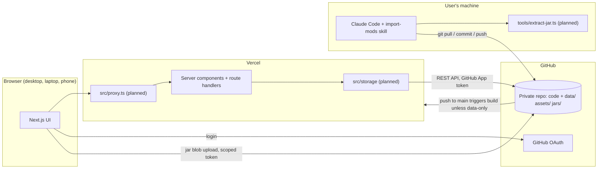
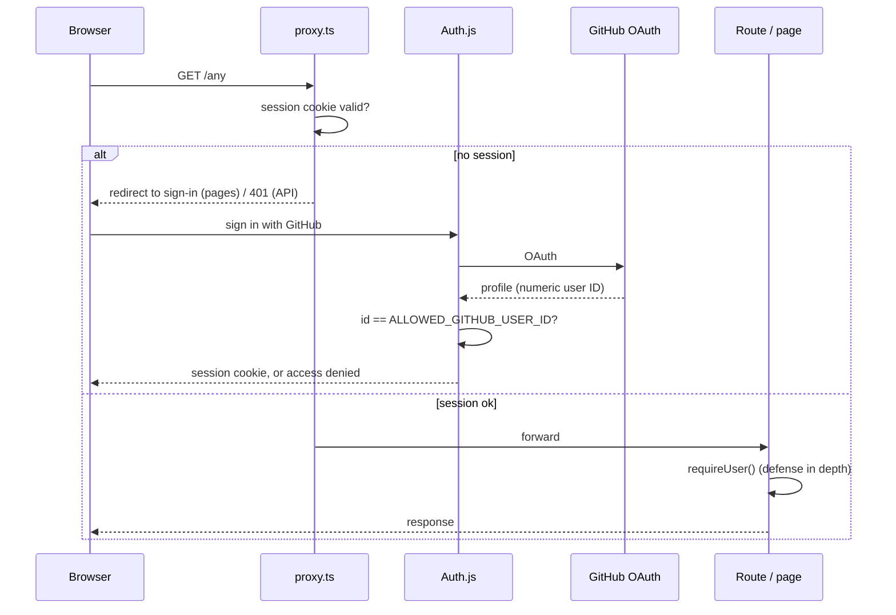
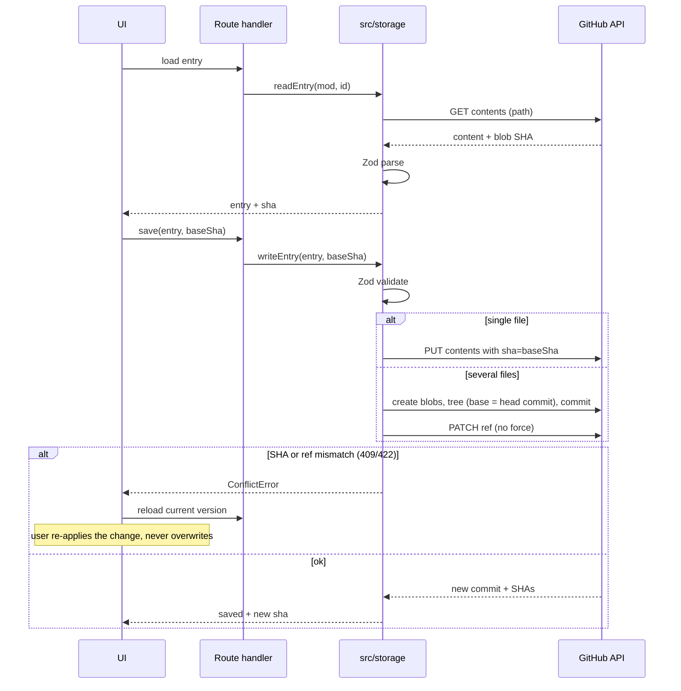
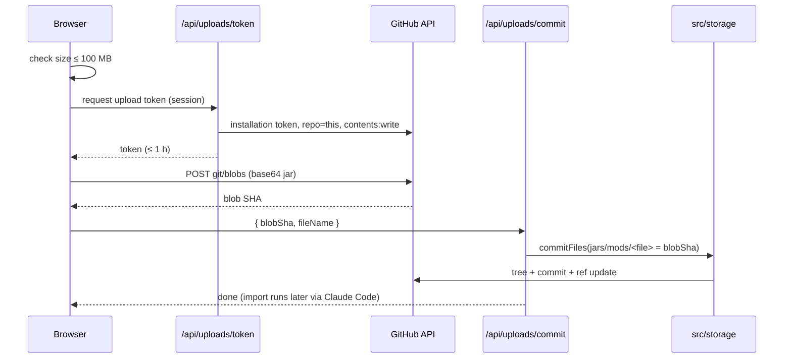
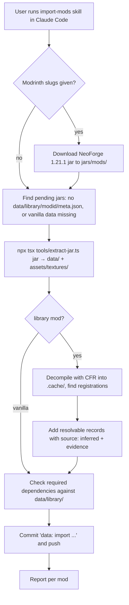
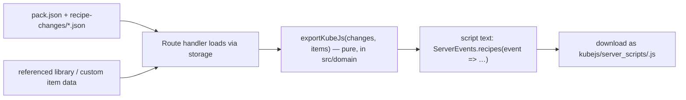

# Architecture

**Status markers:** parts marked **(planned)** do not exist yet; do not import or call them until a phase implements them. Unmarked parts exist now. When a phase implements a planned part, remove its marker in the same change.

Phase 0 status: tooling, docs and the folder skeleton exist. No app features, routes, auth, storage, schemas or tools exist yet.

## System overview



## Components

| Component         | Responsibility                                                                                                      | Status                  |
| ----------------- | ------------------------------------------------------------------------------------------------------------------- | ----------------------- |
| Next.js app       | UI for Mod Designer and Modpack Planner, server components, route handlers (ADR 0001)                               | scaffold                |
| Proxy             | `src/proxy.ts`: rejects every request without an allowlisted session (ADR 0004)                                     | planned                 |
| Auth              | Auth.js GitHub provider, allowlist check, `requireUser()` (ADR 0004)                                                | planned                 |
| Storage layer     | Typed read/write of JSON and PNG documents in the repo, SHA checks, atomic multi-file commits, conflicts (ADR 0002) | planned                 |
| GitHub App client | Installation tokens; scoped upload tokens for jars (ADR 0003, 0005)                                                 | planned                 |
| Texture route     | `/api/textures/[...path]`: serves PNGs from `assets/` behind auth (ADR 0004)                                        | planned                 |
| Domain            | Zod schemas, task rules, recipe model, KubeJS export; pure functions (ADR 0008–0010)                                | planned                 |
| i18n              | English and German UI strings, locale switch                                                                        | planned                 |
| Extraction script | `tools/extract-jar.ts`: deterministic jar → data (ADR 0006)                                                         | planned                 |
| import-mods skill | `.claude/skills/import-mods/SKILL.md`: runs the script, adds inferred data, commits (ADR 0006)                      | exists (script planned) |
| Vercel build skip | `vercel.json` `ignoreCommand`: skips builds for commits touching only `data/`, `assets/`, `jars/` (ADR 0002)        | configured              |

## Source layers

| Folder            | Contains                                                                                                          | May import                             |
| ----------------- | ----------------------------------------------------------------------------------------------------------------- | -------------------------------------- |
| `src/app/`        | Routes: pages, layouts, route handlers (`src/app/api/`, planned). Thin: parse input, call down, render.           | everything below                       |
| `src/components/` | React components, grouped by feature (planned: `components/designer/`, `components/modpacks/`, `components/ui/`). | `domain`, `i18n`, `lib`                |
| `src/domain/`     | Pure TypeScript: Zod schemas and inferred types, task rules, recipe model, KubeJS export.                         | `lib` only (no I/O, React, Next, Node) |
| `src/storage/`    | The only code that reads or writes repo data. Exposes typed functions per document kind.                          | `domain`, `server`, `lib`              |
| `src/server/`     | Server-only infrastructure: env parsing, Auth.js config, `requireUser()`, GitHub App tokens.                      | `lib`                                  |
| `src/i18n/`       | Message catalogs `en` and `de` and lookup helpers. The library is chosen by ADR in the i18n phase.                | `lib`                                  |
| `src/lib/`        | Small generic helpers (e.g. `assert-never.ts`).                                                                   | nothing app-specific                   |
| `tools/`          | CLI scripts run with `npx tsx tools/<script>.ts`.                                                                 | `domain`, `lib`                        |

ESLint (`eslint.config.mjs`) enforces the key boundaries:

- `@octokit/*` is only allowed in `src/storage/` and `src/server/`.
- `src/components/` must not import `@/storage` or `@/server`.
- `src/domain/` must not import React, Next, Node built-ins or upper layers.

Client components get data from server components or by calling route handlers; they never call GitHub.

Tests are colocated as `*.test.ts(x)` and run with Vitest in a Node environment. The storage layer gets an in-memory backend for tests (planned), so features are tested without GitHub.

## Data layout

All paths are relative to the repo root. The folders exist; the data files are planned and appear as phases implement them. File formats are summarized here; once implemented, the Zod schemas in `src/domain/` (planned) are the source of truth. All IDs are namespaced Minecraft IDs (`namespace:path`) unless noted.

```
jars/vanilla/                       vanilla 1.21.1 client jar
jars/mods/                          third-party mod jars (≤ 100 MB each)
data/vanilla/1.21.1/{items,recipes,tags}.json
data/library/<modid>/{meta,items,recipes,tags}.json
data/custom-mods/<modid>/{mod,layout,tasks}.json + entries/<entry-id>.json
data/modpacks/<pack-id>/{pack,tasks}.json + recipe-changes/<change-id>.json
assets/textures/<namespace>/        PNGs extracted from jars (vanilla and library mods)
assets/icons/<custom-modid>/        16×16 PNG icons drawn in the pixel editor, one per entry
tools/extract-jar.ts                (planned)
```

| File                                                      | Holds (high level)                                                                              | Written by         |
| --------------------------------------------------------- | ----------------------------------------------------------------------------------------------- | ------------------ |
| `data/vanilla/1.21.1/items.json`, library `items.json`    | array of `{ id, name (English), icon (path under assets/textures or null), source, evidence? }` | extraction + skill |
| `.../recipes.json`                                        | array of `{ id, type, ingredients/result as in 1.21.1 recipe JSON, source, evidence? }`         | extraction + skill |
| `.../tags.json`                                           | item tags: `{ "<tag-id>": ["<item-id>" or "#<tag-id>", ...] }`                                  | extraction         |
| `data/library/<modid>/meta.json`                          | mod ID, name, version, loader, Minecraft version, jar path, jar hash, declared dependencies     | extraction         |
| `data/custom-mods/<modid>/mod.json`                       | mod ID, name, description, current phase                                                        | app                |
| `data/custom-mods/<modid>/layout.json`                    | mind map node positions per entry ID                                                            | app                |
| `data/custom-mods/<modid>/tasks.json`                     | manual tasks; per-key state for generated tasks if the Designer spec needs it                   | app                |
| `data/custom-mods/<modid>/entries/<entry-id>.json`        | one entry: `id, type, kind?, name, status`, type-specific fields, recipes, relations, icon      | app                |
| `data/modpacks/<pack-id>/pack.json`                       | pack ID, name, referenced library mod IDs and custom mod IDs                                    | app                |
| `data/modpacks/<pack-id>/tasks.json`                      | manual tasks                                                                                    | app                |
| `data/modpacks/<pack-id>/recipe-changes/<change-id>.json` | one recipe change: action (add / remove / replace), target, new recipe                          | app                |

Rules:

- `data/custom-mods/` and `data/modpacks/` are written only by the app.
- `data/library/` and `data/vanilla/` are written only by the import.
- Prettier ignores `data/`, `assets/` and `jars/`; their writers define the formatting (sorted keys and arrays, 2-space JSON, trailing newline).

## Flows

### Login and authorization (planned)



### Read and write via the storage layer (planned)



### Jar upload (planned)



### Import pipeline (script planned, skill exists)



The CFR jar and decompiled sources go in `.cache/` (created on demand, gitignored).

### KubeJS export (planned)



## Environment variables

Listed in `.env.example`; none are read yet. Parse and validate them in `src/server/` (planned), never with `process.env` scattered in features.

## Framework notes

- Next.js 16.4 with defaults from create-next-app: `cacheComponents`, `partialPrefetching`, and Tailwind v4 through the `@tailwindcss/turbopack` loader (no PostCSS config). The middleware file is called `proxy.ts`.
- There is no `public/` folder. Next.js serves it without auth, so textures and icons never go there (ADR 0004).
- Version-matched Next.js docs are in `node_modules/next/dist/docs/`; `AGENTS.md` is maintained by `next dev` and says the same.
